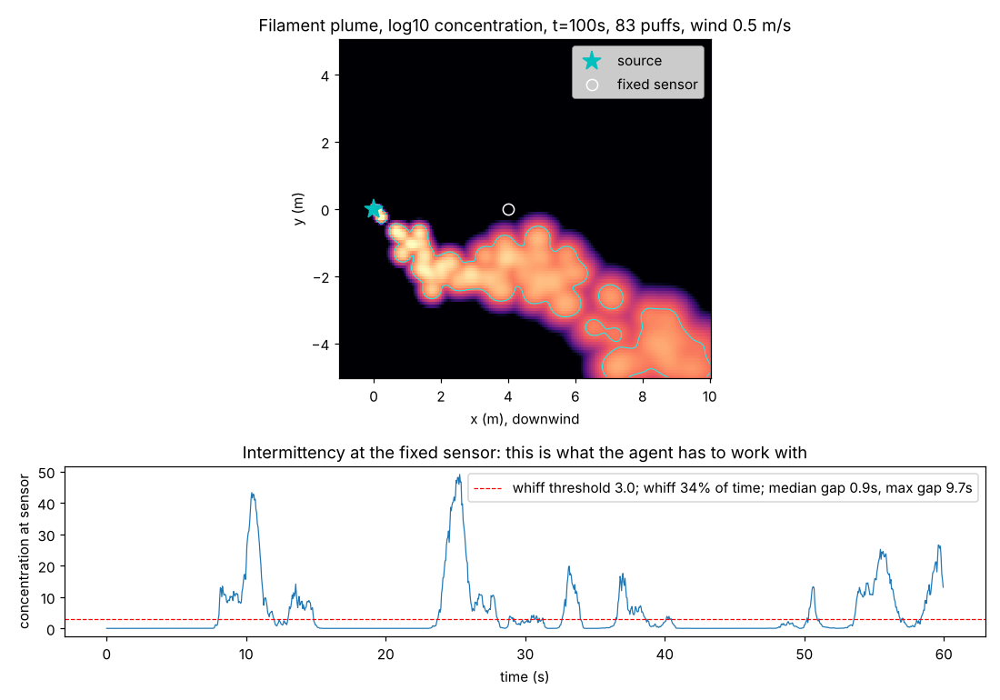
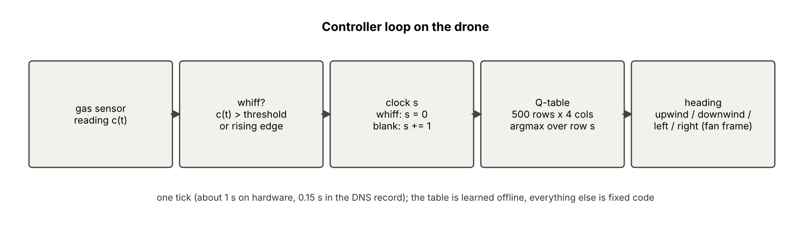

# plumesearch

Putting a simulation-only odor-search policy on a small drone.

A group of statistical physicists has shown, in simulation, that an agent whose whole memory is a single number (time since it last smelled anything) can find an odor source in turbulent air, and that the behavior it learns looks like what moths do: surge upwind on a whiff, cast sideways when lost, drift back downwind after a long blank. The policy is a 500 × 4 lookup table trained by Q-learning in direct numerical simulations of turbulence. It has not been run on hardware. This project implements it, reproduces the published results, measures how it degrades under a real gas sensor, and flies it on a quadrotor against the classical cast-and-surge heuristic.

*Top: a snapshot of the puff-based plume simulator written for this project, log concentration, wind left to right. Bottom: what a sensor 4 m downwind reads over a minute. Smell arrives in bursts separated by gaps of seconds; there is no gradient to climb. This is the regime the controller is built for.*

## Why this problem

In still air, smell fades smoothly with distance and you can follow it uphill. In moving air, turbulence tears the plume into filaments, and a sensor downwind reads zero most of the time with brief bursts in between. Consecutive readings carry no direction information. What does carry information is the timing of bursts and gaps, which depends on where the sensor is relative to the source. Insects solve this with cheap sensors and tiny brains; robots mostly do not.

## The controller

Each tick the drone reads its gas sensor, decides whether that is a whiff, updates a counter (reset to zero on a whiff, plus one on a blank), looks up the counter's row in a table, and moves one step in the direction the table prefers, with directions defined relative to the wind. The table is the only learned part. Everything around it is a few dozen lines of fixed code.

The table comes from Rando, Heinonen, Qi and Seminara (2026), "Clock-state olfactory search in turbulent flows using Q-learning" ([arXiv 2605.15938](https://arxiv.org/abs/2605.15938)). Piro, Carbone, Biferale and Cencini (2026, [arXiv 2605.21329](https://arxiv.org/abs/2605.21329)) add an onboard wind estimate to the same agent. Version 1 of this project uses a stationary fan, so the wind direction is a known constant and the Rando setting applies directly.

## What is in the repo

| Path | What it is | Status |
|---|---|---|
| `plume.py` | Puff-based turbulent plume simulator (Farrell et al. 2002 model class) with a crosswind meander, used as a second training environment and for conditions the DNS record cannot represent | done, tested |
| `tests/` | pytest suite | 3 passing |
| `docs/problem_and_approach.md` | The problem, the controller, training environments, evaluation plan, hardware plan | current |
| `docs/engineering_challenges.md` | Ten gaps between the simulation and a flying drone, with what is known, the plan, and a status for each | current |
| `docs/plume_model.md` | The plume model, including two earlier versions that produced no intermittency and why | current |

Planned, in order: `sensor.py` (measured gas-sensor response as a filter), `agent.py` (clock-state Q-learning agent matching the paper's methods), `policies.py` (cast-and-surge baseline as in the paper's Algorithm 1, random walk), `train.py`, `eval.py`, `drone_env.py`.

## Plan

1. Read the source papers and the authors' released code ([pynav](https://github.com/PimLb/pynav)) and record every design choice.
2. Reproduce the published success rates on the authors' DNS record ([Zenodo 20001730](https://zenodo.org/records/20001730)).
3. Bench-test a metal-oxide gas sensor: rise time, recovery time, noise under step exposure to ethanol. This measurement does not exist in the literature and decides how the policy has to be trained.
4. Retrain with the measured sensor response and the hardware tick in the loop; sweep response time to get a degradation curve for each controller.
5. Fly the learned table, cast-and-surge, and a random walk on identical trials: small quadrotor, one gas sensor, stationary fan, ethanol source, overhead camera for scoring.

## Where this came from

This started as an attempt to put the FlyWire fruit-fly connectome on a drone. Several projects claim to have done it, and the drone does fly. Reading the best-known one's code, the brain turns out to be decorative: the simulation keeps one synapse in a hundred, integrates with a time step fifty times longer than the membrane time constant so a third of the network saturates every tick, cancels inhibition to exactly zero, and reads "thrust" as the number of descending neurons that spiked. The output is a near-constant, and the script that actually flies the Tello drives it with sine waves of the wall clock and contains no neurons. Done correctly it would still not work: a connectome is a wiring map without synaptic strengths, dynamics or neuromodulation, and the circuits that stabilize a fly's flight run through the ventral nerve cord and halteres, which are not in the brain dataset.

The useful lesson was to copy what insects do, not what they are made of. Moths find a mate's pheromone across hundreds of metres of turbulent air with a sensor and a brain a drone can match, using a strategy (surge on contact, cast when lost) that is well described. In 2025 and 2026 a group of statistical physicists showed that this strategy emerges on its own when an agent with one integer of memory is optimized by reward in simulated turbulence, and that the learned version beats the hand-coded one. Nothing here copies a neuron. The project takes that strategy, which so far exists only in simulation, and gives it a cheap body. The FlyWire part is written up separately, with the code quoted.

## Status

Simulation phase. No hardware yet. See `docs/engineering_challenges.md` for what is open.

## References

- Rando, Heinonen, Qi, Seminara. Clock-state olfactory search in turbulent flows using Q-learning. arXiv 2605.15938, 2026.
- Rando, James, Verri, Rosasco, Seminara. Q-learning with temporal memory to navigate turbulence. eLife 102906, 2025.
- Piro, Carbone, Biferale, Cencini. Smart strategies to navigate turbulent odor plumes reorienting to local wind. arXiv 2605.21329, 2026.
- France, Daescu, Khan, Peddi. Chasing Ghosts: a simulation-to-real olfactory navigation stack. arXiv 2602.19577, 2026.
- Thomas, Bridges, Bergbreiter. Airflow source seeking on small quadrotors using a single flow sensor. arXiv 2601.15607, 2026.
- Farrell, Murlis, Long, Li, Cardé. Filament-based atmospheric dispersion model to achieve short time-scale structure of odor plumes. Environmental Fluid Mechanics, 2002.
